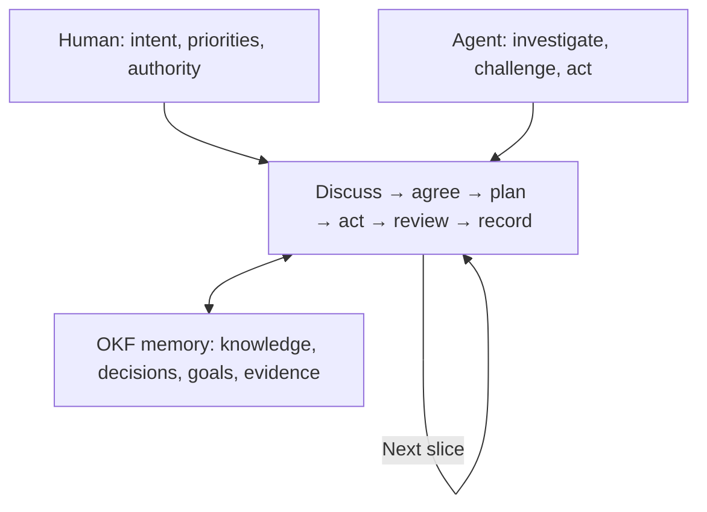

# Agent Skills

Reusable skills for AI coding agents.

## Skills

- [goal-memory](skills/goal-memory/SKILL.md) — Work through substantial goals with focused questions, private project context, and small reviewable steps.

## How goal-memory works

The human sets intent, priorities and the boundaries for decisions and approvals. The agent investigates, challenges assumptions, recommends a path and carries out authorized work. Together they discuss and agree on the next useful slice, plan it, act, review and record what happened. Explicit instructions can change the default review rhythm or delegate decisions for unattended work.

For substantial goals, private memory connects knowledge, decisions, goals, phases and evidence so work can resume with context. The agent follows indexes to relevant records and source files, asks short questions when judgment is needed, and updates records as understanding changes. It learns durable working preferences from evidence and applies confirmed patterns within the authority given.

### Why OKF

[Open Knowledge Format (OKF)](https://github.com/GoogleCloudPlatform/knowledge-catalog/blob/main/okf/SPEC.md) uses accessible Markdown and metadata so people and agents can read, navigate and maintain knowledge across tools. Its provenance, trust, freshness, lifecycle and attestation concepts help consumers judge where knowledge came from and whether it remains reliable. The skill's [local OKF profile](skills/goal-memory/references/SPEC.md) defines the subset and additional rules used for private memory; it does not implement every upstream feature. Use the upstream specification for the full format.

## Install

Copy the entire `skills/goal-memory` directory into your agent's skills directory. For Codex, use `~/.codex/skills/goal-memory/` for a personal installation, or the project's `.agents/skills/goal-memory/` for a project installation. Keep `SKILL.md`, `references/`, and `templates/` together.

Invoke the skill as `$goal-memory` in a supported agent. The skill can also be selected automatically when appropriate; selection depends on the agent and its configuration.

Describe the goal, relevant project and any constraints or decision authority. The agent inspects the project and guides discussion, planning and review in small steps. See the [operating guide](skills/goal-memory/references/HOW-TO-USE.md) for collaboration, memory navigation and recovery, and the [skill definition](skills/goal-memory/SKILL.md) for the workflow and reference entry points.

For substantial goals, the skill creates a private `memory temp/` directory in the project. Its Git ignore rule does not remove already tracked files or protect against deletion. Review the skill before using it in your own workflow.

## Contributing

See [CONTRIBUTING.md](CONTRIBUTING.md). Contributions are accepted under the [MIT License](LICENSE).
